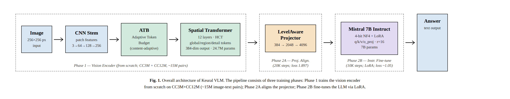
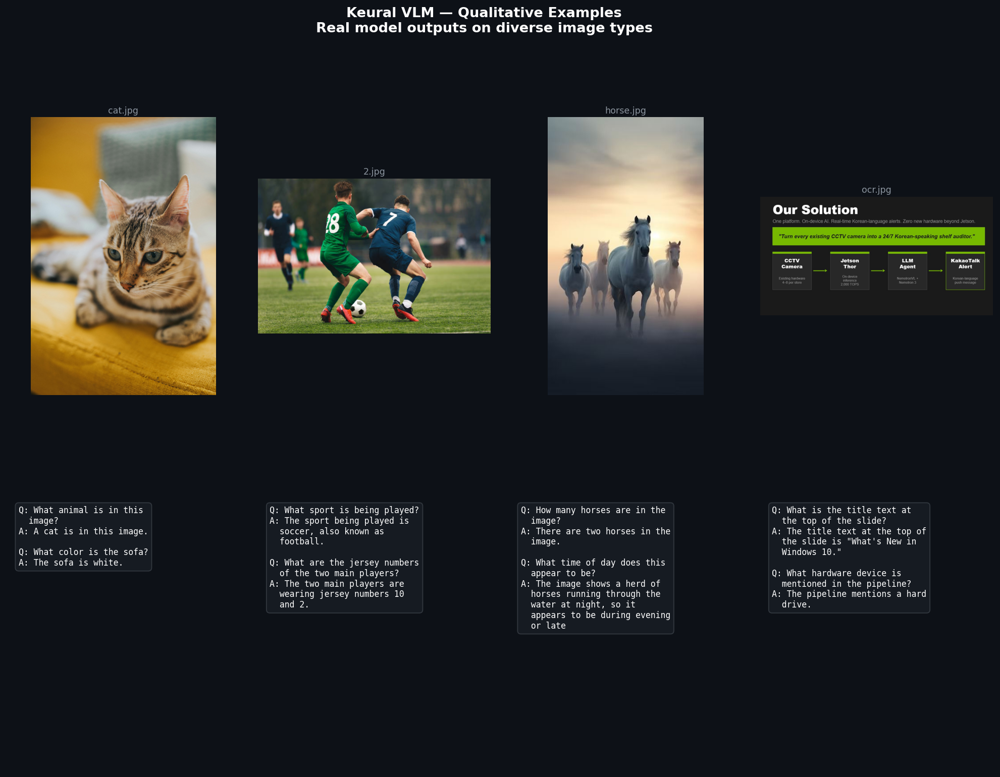
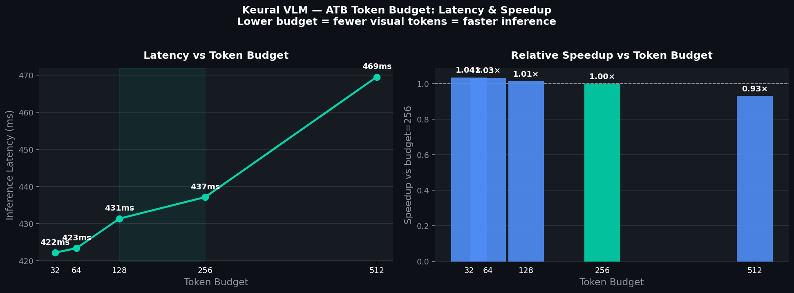
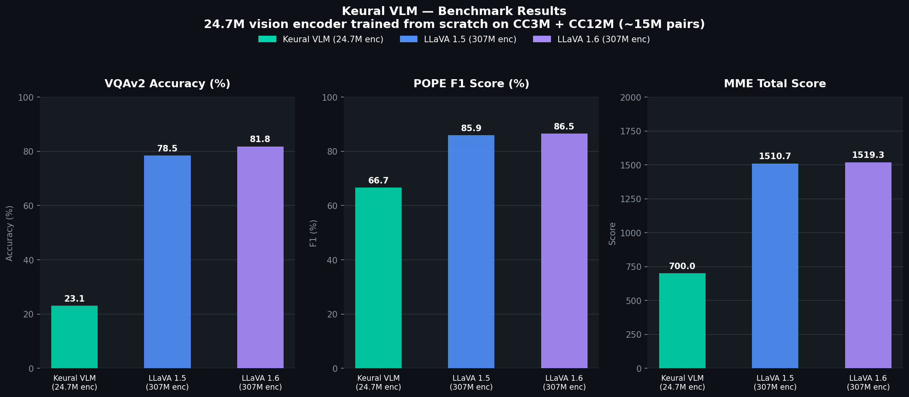

# Keural Vision Encoder

Keural vision encoder designed for the LLM era. Plug-in compatible with any LLM via a clean output contract.

> **Status: V0.1-preview.** Architecture is complete and validated by 300+ unit tests. Full training runs on CC3M + CC12M (~6.9M samples) on a single RTX 5090 in 24–36 hours.

---

## VLM Pipeline Architecture



The full Keural VLM pipeline consists of three training phases:

| Phase | Component | Steps | Dataset | Final Loss |
|---|---|---|---|---|
| Phase 1 | Vision Encoder (24.7M params) | ~75,000 | CC3M + CC12M (~15M pairs) | pooled norm 3.47 |
| Phase 2A | LevelAware Projector (384→2048→4096) | 20,000 | CC3M + CC12M captions | 1.897 |
| Phase 2B | Mistral 7B + LoRA instruction fine-tuning | 10,000 | LLaVA-Instruct-150K + COCO | ~1.05 |

**VLM weights on HuggingFace:** [`mkd-hika/keural-vlm-poc`](https://huggingface.co/mkd-hika/keural-vlm-poc)

---

## Qualitative Examples



Real model outputs on diverse image types (animal, sport, scene, OCR/text slide).

---

## ATB Token Budget — Latency & Speedup



The **Adaptive Token Budget (ATB)** lets you trade visual detail for speed at runtime:

```python
out_fast  = encoder(image, token_budget=64)   # 422ms — low detail, fast
out_mid   = encoder(image, token_budget=256)  # 437ms — recommended default
out_dense = encoder(image, token_budget=512)  # 469ms — maximum detail
```

No other open-source vision encoder exposes this control at the token level.

---

## Benchmark Results



| Benchmark | Keural VLM (24.7M enc) | LLaVA 1.5 (307M enc) | LLaVA 1.6 (307M enc) |
|---|---|---|---|
| VQAv2 Accuracy | 23.1% | 78.5% | 81.8% |
| POPE F1 | 66.7% | 85.9% | 86.5% |
| MME Total Score | 700.0 | 1510.7 | 1519.3 |

> **Note:** Keural uses a **24.7M custom encoder trained from scratch** on ~15M pairs vs LLaVA's 307M CLIP encoder pretrained on 400M+ pairs (12× more params, 26× more data). The gap reflects encoder scale, not architecture limitations.

---

## What makes this different

Vision encoders for the LLM era have unsolved problems:

1. **Token count grows quadratically with resolution.** A 1024² image at standard patch size produces 5,329 tokens — an LLM context killer.
2. **Token count is determined by pixels, not content.** A blank wall and a dense city street get the same number of tokens.
3. **Output structure is flat.** LLMs have to infer what's "important" from a uniform sequence.

Keural attacks all three with two genuinely novel contributions:

### Adaptive Token Budget (ATB) Tokenization

The number of tokens is a **runtime parameter**:

```python
out_cheap   = encoder(image, token_budget=64)    # 64 tokens, low cost
out_default = encoder(image, token_budget=256)   # 256 tokens, default
out_dense   = encoder(image, token_budget=1024)  # 1024 tokens, full fidelity
```

Tokens are allocated to **information-dense regions**, not uniformly. A blank wall gets fewer tokens. A dense document gets more. No other encoder on Hugging Face does this.

### Hierarchical Concept Tokenization (HCT)

Tokens come at three semantic levels: **global** (whole-image), **region** (object-scale), and **detail** (fine-grained). The LLM receives structured output instead of a flat sequence:

```python
out = encoder(image)
print(out.level_ids)  # tensor of {0, 1, 2} — global / region / detail
```

---

## Prerequisites

- Python 3.10+
- CUDA GPU (RTX 3090 / 4090 / 5090 recommended, ≥ 16 GB VRAM for POC config)
- ~700 GB disk space for CC3M + CC12M datasets

---

## Installation

```bash
git clone https://github.com/your-org/keural-vision-encoder
cd keural-vision-encoder

pip install torch torchvision --index-url https://download.pytorch.org/whl/cu124
pip install transformers sentence-transformers webdataset pyyaml pillow tqdm psutil pynvml
```

---

## Dataset Setup

The training pipeline expects datasets in **WebDataset (tar shard) format** with a **TSV index file**.

### Directory layout

```
poc/
├── data/
│   ├── cc3m/           ← CC3M tar shards  (*.tar)
│   ├── cc12m/          ← CC12M tar shards (*.tar)
│   └── indexes/
│       ├── cc3m_wds_train.tsv
│       └── cc12m_wds_train.tsv
```

### Index TSV format

Each row in the TSV index has five tab-separated columns:

```
caption<TAB>shard_filename<TAB>sample_id<TAB>width<TAB>height
```

Example:
```
A dog running on the beach<TAB>00042.tar<TAB>000421<TAB>512<TAB>384
```

### Downloading CC3M

CC3M is available in WebDataset format on Hugging Face:

```bash
# Install huggingface_hub
pip install huggingface_hub

# Download (requires HF account)
python -c "
from huggingface_hub import snapshot_download
snapshot_download('pixparse/cc3m-wds', local_dir='data/cc3m', repo_type='dataset')
"
```

Then build the index TSV from the shard metadata JSONs:

```bash
python scripts/build_index.py --src data/cc3m --output data/indexes/cc3m_wds_train.tsv
```

### Downloading CC12M

```bash
python -c "
from huggingface_hub import snapshot_download
snapshot_download('pixparse/cc12m-wds', local_dir='data/cc12m', repo_type='dataset')
"
python scripts/build_index.py --src data/cc12m --output data/indexes/cc12m_wds_train.tsv
```

### Verifying the dataset

```bash
# Check shard count and row count
wc -l data/indexes/cc3m_wds_train.tsv
ls data/cc3m/*.tar | wc -l

# Spot-check a shard
tar -tf data/cc3m/00000.tar | head -20
```

### Optional: filter by quality

Run the two-pass quality filter (CLIP score + caption/resolution checks) before training:

```bash
python scripts/filter_index.py \
    --index data/indexes/cc3m_wds_train.tsv data/indexes/cc12m_wds_train.tsv \
    --images-root data/cc3m data/cc12m \
    --output data/indexes/cc3m_wds_train_filtered.tsv data/indexes/cc12m_wds_train_filtered.tsv \
    --min-words 5 --min-size 200 --max-aspect 3.0 --clip-threshold 0.25
```

---

## Training

### Quick smoke test (no GPU required)

Validates the full pipeline on synthetic data in under 30 seconds:

```bash
cd poc
python -m training.train \
    --config configs/keural_smoke.yaml \
    --synthetic --synthetic-size 64 --max-steps 5 \
    --output-dir ./outputs/smoke_test
```

You should see loss decreasing across 5 steps.

### POC training on a single GPU (~24–36 hours on RTX 5090)

The POC model is 24.7M parameters (embed=384, depth=12, 6 heads). It trains on CC3M + CC12M using the watchdog launcher which auto-restarts on crash and resumes from the last checkpoint:

**Step 1 — Check your disk has enough free space (need ~50 GB for checkpoints/logs):**

```bash
df -h /
```

**Step 2 — Clear old logs (optional):**

```bash
> poc/logs/train_run1.log
> poc/logs/watchdog.log
```

**Step 3 — Launch training with the watchdog:**

```bash
cd poc
nohup bash scripts/launch_training.sh > /dev/null 2>&1 &
echo "Training PID: $!"
```

The watchdog:
- Auto-restarts training within 5 minutes if it crashes (up to 10 times)
- Resumes from the last checkpoint on restart
- Keeps only the 5 most recent checkpoints
- Logs all restart events to `logs/watchdog.log`

**Step 4 — Monitor progress:**

```bash
# Live training log (loss, GPU, ETA)
tail -f poc/logs/train_run1.log

# Watchdog events (restarts, crashes)
tail -f poc/logs/watchdog.log

# GPU status
nvidia-smi
```

**Step 5 — Stop training:**

```bash
# Gracefully stop (training saves a checkpoint before exit)
kill $(cat poc/logs/train.pid)

# Force stop everything
pkill -9 -f "training.train"
```

### Training log format

Each log line looks like:

```
[train] step= 5000/75000 (6.7%) ETA=22h 14m lr=9.80e-04 loss=4.2318 primary=3.1204 hct=0.8821 sal=0.2293 grad_norm=1.24e+00 | gpu=99% mem=18240/32607MB temp=72°C cpu=12.0% ram=18.42/61.93GB (0.8s)
```

| Field | Meaning |
|---|---|
| `step` | Current / total steps |
| `ETA` | Estimated time remaining |
| `lr` | Current learning rate |
| `loss` | Total loss |
| `primary` | Sigmoid contrastive (SigLIP) loss |
| `hct` | Hierarchical concept tokenization auxiliary loss |
| `sal` | Saliency regularisation loss |
| `grad_norm` | Gradient norm (watch for spikes > 10) |
| `gpu` | GPU utilisation % |
| `mem` | VRAM used / total (MB) |
| `temp` | GPU temperature °C |
| `cpu` | CPU utilisation % |
| `ram` | System RAM used / total (GB) |
| `(Xs)` | Wall-clock time for this step |

All steps are also saved to `outputs/run/training_log.jsonl` for offline analysis.

### Checkpoint layout

```
outputs/run/
├── checkpoint_step_5000/
│   ├── config.pt            ← model config dict
│   ├── model.pt             ← model weights
│   └── training_state.pt    ← optimizer + scaler + step (for resume)
├── checkpoint_step_10000/
│   └── ...
├── error.log                ← written on crash with reason + traceback
└── training_log.jsonl       ← full log in JSON format
```

Only the **5 most recent** checkpoints are kept. Older ones are deleted automatically.

### Resuming from a checkpoint

The training loop resumes automatically on restart. To resume manually:

```bash
cd poc
python -m training.train \
    --config configs/keural_tiny_poc.yaml \
    --output-dir outputs/run
```

It finds the latest `checkpoint_step_N/` directory and loads model weights + optimizer state.

### CLI flags

```bash
python -m training.train --help

  --config          Path to YAML config file
  --output-dir      Directory to save checkpoints and logs
  --max-steps N     Override max_steps from config
  --batch-size N    Override batch_size_per_device from config
  --max-samples N   Cap dataset size (useful for quick tests)
  --synthetic       Use synthetic random data (no real dataset needed)
  --synthetic-size  Number of synthetic samples (default: 1000)
```

---

## Project structure

```
poc/
├── architecture/
│   ├── encoder.py              ← Full KeuralVisionEncoder model
│   └── spatial/
│       ├── block.py            ← Pre-norm RMSNorm + RoPE attention + SwiGLU MLP
│       └── rope_2d.py          ← 2D-RoPE for irregular token positions
├── tokenizer/
│   ├── stem.py                 ← Variable-resolution conv stem (16× stride)
│   ├── saliency.py             ← Saliency predictor head
│   ├── region_sampler.py       ← Differentiable Gumbel-Top-K with NMS
│   ├── token_constructor.py    ← Assembles global + region + detail tokens
│   └── atb_tokenizer.py        ← Main: image → hierarchical token sequence
├── alignment/
│   ├── output_contract.py      ← KeuralEncoderOutput dataclass (stable API)
│   ├── projectors.py           ← Simple / LevelAware / Metadata projectors
│   ├── vlm_helpers.py          ← build_vlm_inputs helper
│   └── hf_wrapper.py           ← HuggingFace AutoModel integration
├── training/
│   ├── losses.py               ← SigLIP + HCT auxiliary + saliency reg losses
│   └── train.py                ← Training loop with CLI, resume, monitoring
├── data/
│   ├── datasets.py             ← CC3M/CC12M WebDataset loader + BucketedSampler
│   └── DATA.md                 ← Data pipeline design doc
├── scripts/
│   ├── launch_training.sh      ← Watchdog launcher (auto-restart + resume)
│   └── filter_index.py         ← Two-pass quality filter (words + CLIP score)
├── configs/
│   ├── keural_tiny_poc.yaml    ← POC config: 24.7M params, single GPU
│   ├── keural_smoke.yaml       ← Smoke test: tiny model, 5 steps
│   └── architecture/
│       ├── phase1_poc.json     ← Phase 1: 24.7M  (single RTX 5090, ~24-36h)
│       ├── phase2_mid.json     ← Phase 2: ~250M  (8× H100, 7-14 days)
│       └── phase3_commercial.json ← Phase 3: ~1.1B (64× H100, 30-60 days)
├── tests/                      ← 300+ unit tests
└── keural_config.py            ← Config dataclasses + YAML serialisation
```

---

## Output contract

Every forward pass returns a `KeuralEncoderOutput`:

| Field | Shape | Description |
|---|---|---|
| `tokens` | `(B, N, D)` | Token vectors |
| `attention_mask` | `(B, N)` | 1 = real token, 0 = padding |
| `level_ids` | `(B, N)` | 0 = global, 1 = region, 2 = detail |
| `spatial_metadata` | `(B, N, 4)` | Per-token (cx, cy, w, h) normalized to [0,1] |
| `saliency_scores` | `(B, N)` | Allocator confidence per token |
| `pooled` | `(B, D)` | Single-vector image summary |
| `token_budget_used` | `(B,)` | Actual tokens used per batch item |

This contract is **stable across the entire v0.x line.**

---

## Projectors

All projectors take a `KeuralEncoderOutput` and return `(B, N, llm_dim)`:

| Projector | Use when |
|---|---|
| `SimpleProjector` | Drop-in replacement for CLIP/ViT — ignores level info |
| `LevelAwareProjector` | **Recommended default** — adds learned per-level bias |
| `MetadataProjector` | Spatial reasoning / OCR / documents — fuses position info |

```python
from alignment.projectors import LevelAwareProjector
projector = LevelAwareProjector(encoder_dim=384, llm_dim=4096)
llm_input_embeds = projector(encoder_output)
```

---

## Phases

| Phase | Params | Hardware | Training Time | Config |
|---|---|---|---|---|
| POC | 24.7M | Single RTX 5090 | 24–36 h | `phase1_poc.json` |
| Mid | ~250M | 8× H100 80 GB | 7–14 days | `phase2_mid.json` |
| Commercial | ~1.1B | 64× H100 80 GB | 30–60 days | `phase3_commercial.json` |

Each phase starts from the **previous phase's checkpoint** (embed_dim must match or a projector is used). Phase 1 → Phase 2 requires projecting from embed_dim=384 to 768.

---

## Publishing to Hugging Face

After training completes (step 75000), export and upload the model:

```bash
# 1. Export final weights
python -c "
import torch
from architecture.encoder import KeuralVisionEncoder
from keural_config import KeuralConfig
import yaml

cfg = KeuralConfig.from_yaml('configs/keural_tiny_poc.yaml')
model = KeuralVisionEncoder(cfg)
ckpt = torch.load('outputs/run/checkpoint_step_75000/model.pt')
model.load_state_dict(ckpt)
model.save_pretrained('outputs/keural-tiny-poc-final')
"

# 2. Push to Hugging Face Hub
pip install huggingface_hub
python -c "
from huggingface_hub import HfApi
api = HfApi()
api.upload_folder(
    folder_path='outputs/keural-tiny-poc-final',
    repo_id='your-username/keural-tiny-poc',
    repo_type='model',
)
"
```

---

## Running tests

```bash
cd poc
python -m pytest tests/ -v
```

---

## Status & roadmap

**V0.1-preview (current):**
- Full architecture implemented (~4,500 lines, 300+ tests passing)
- Training loop with GPU/CPU monitoring, ETA, auto-restart watchdog
- Checkpoint rotation, crash logging, resume support
- HF integration: `AutoModel.from_pretrained()` works
- Three projectors + VLM helpers shipped
- Evaluation scripts: ImageNet zero-shot, budget curve, level probe

**V0.2 (planned):**
- Multi-GPU training (DDP)
- Detail-patch reconstruction loss component for HCT
- Real benchmark numbers vs SigLIP / DINOv2

**V1.0 (when more compute is available):**
- Production weights at Mid (250M) and Commercial (1.1B) scales
- Full evaluation suite vs published encoders

---

## License

Code: MIT. Training data licenses (CC3M, CC12M) apply to weights produced by this code.

---

## Citation

```bibtex
@misc{keural_vision_encoder_2026,
  title  = {Keural Vision Encoder: Content-Adaptive Vision Encoding via Saliency-Guided Token Budgets},
  year   = {2026},
  note   = {V0.1-preview},
}
```
